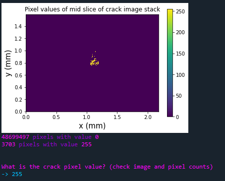
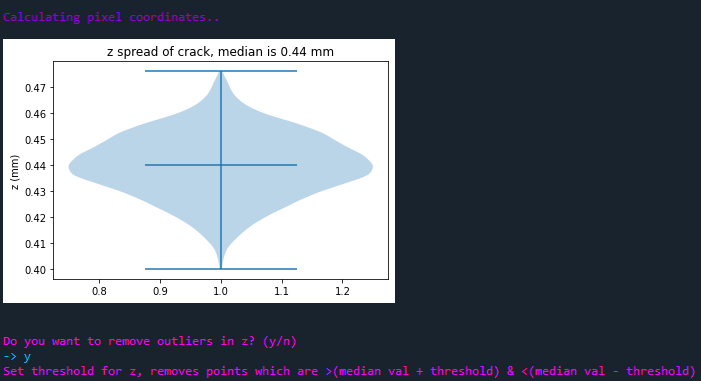
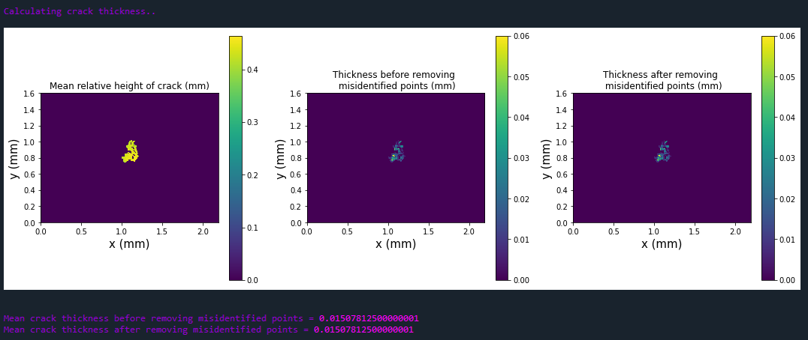

## Description

This software is intended for the analysis and quantification of segmented crack images obatianed from X-ray computed tomography data.

In principle this code can also be used on any other segmented image where the user would like to see a color map of the feature thickness or height.

## Setup
Clone the repository (or download it's contents manually):
```shell
git clone https://github.com/Bhejazi/crack-thickness.git
```

The project is managed with [uv](https://docs.astral.sh/uv/). Install uv (once):
```shell
# Windows
powershell -ExecutionPolicy ByPass -c "irm https://astral.sh/uv/install.ps1 | iex"
# macOS / Linux
curl -LsSf https://astral.sh/uv/install.sh | sh
```

Create the environment (Python 3.12 from `.python-version`, dependencies pinned in `uv.lock`):
```shell
setup_venv.bat
```
On Windows the venv is placed on the local disk at `%LOCALAPPDATA%\crack-thickness\.venv`, not in the project folder. Without uv, the script falls back to `python -m venv` + `pip`. The run scripts below call setup automatically if the venv is missing.

On macOS / Linux, `uv sync` creates `.venv` in the project folder.

## Usage

### GUI
Double-click `run_gui.bat` (or `uv run crack_thickness_gui.py` on macOS / Linux).

1. **Browse...** to the folder with the segmented `.tif` slices. The voxel size is read from the TIFF resolution tags when available (check it), otherwise enter it in µm.
2. **Load images**. A mid-slice preview, the pixel value counts and the z spread of the crack are shown. Select the crack pixel value (default: the most frequent non-zero value).
3. Optionally enable **Z outlier removal** (removes slices further than the threshold, in mm, from the median crack height).
4. Select the **thickness method**:
   - **Binned max-min**: the xy plane is split into square bins of the given bin size (mm); thickness per bin is max(z) − min(z) of the crack voxel centres. Empty and zero-extent bins are ignored and bins > 5× the mean are discarded as misidentified.
   - **Continuous columns (tilt-corrected)**: in every (y, x) voxel column the longest unbroken run of crack voxels along z is the crack opening (optionally: total crack voxels in the column). With tilt correction this is projected onto the local crack-plane normal, `t_perp = t_run · cos(φ)`, where φ is the local inclination of the Gaussian-smoothed (σ, µm) crack mid-surface; columns steeper than the maximum inclination are excluded. This is the measure used in the device-comparison study.
5. **Calculate thickness**. The mean height map, the before/after (max-min) or inclination (continuous) map, the thickness map and the thickness histogram are shown, with summary statistics (mean, median, SD, P10–P90, n, mean in voxels).
6. **Save figure...** (`.pdf`/`.png`/`.svg`) and **Export thickness map (CSV)...** (also writes a `_summary.txt` with the settings and statistics).

Thickness values are in µm, x/y in mm. The calculations live in `crack_thickness.py` and can be imported for scripted use.

### Command line
Run `run_cli.bat` (or `uv run crack_thickness_from_images.py` on macOS / Linux).
- The program is used via a command line interface. (To run it from an editor, select `%LOCALAPPDATA%\crack-thickness\.venv\Scripts\python.exe` as the interpreter.)

- The program will now prompt you to `Enter image file path:`
##
### Note on input image file format
The program accepts segmented `.tif` images of the crack or feature being analyzed.
##

- Once file path is entered the program will ask `What is the voxel size? (in um)`.

  Enter the known experimental voxel size so that calculations and output are in appropriate dimensions.

- After images are loaded you will need to specify the segmented crack pixel value.

  You can use the sample slice image and count of pixel values in the entire image stack to check the crack pixel value.



- After entering the crack pixel value, pixel coordinates are calculated and the height (z) spread of pixels is displayed.

  You can decide if any pixels should be considered outliers and whether they need to be deleted.

  `Do you want to remove outliers in z? (y/n)`

  If you would like to remove outliers then specify the z threshold.



- Next you select the thickness method: `1` binned max-min or `2` continuous columns (longest unbroken run per column, with optional tilt correction, smoothing σ and maximum inclination).

- For the binned max-min method you will be prompted to determine the bin size for how the data will be binned and displayed: Here each bin is a square with the size given by the binsize value.

  `Set binsize for crack thickness calculation in mm (start with 0.01 and adjust for higher or lower resolution)`.

  -> The thickness across the cross-section of the crack is calculated by taking the difference between the maximum and minimum values of the point cloud in a given bin.

  -> The mean crack thickness is also reported. Here the mean thickness is the mean of all the local binned thicknesses across the crack.

  After calculation is complete the crack thickness and relative crack height are displayed on a colormap.



- In the end you will be asked if you would like to save the output figure and to enter the save path. The output figure is saved as a `.pdf` file.

  You can also decide to try another method or binsize and optimize the output or complete the analysis.

## Citation

Hejazi et. al. (2025), "Fatigue Crack Segmentation and Characterization of Additively Manufactured Ti-6Al-4V Using X-Ray Computed Tomography". Fatigue Fract Eng Mater Struct, 48: 204-216.

DOI: https://doi.org/10.1111/ffe.14489
